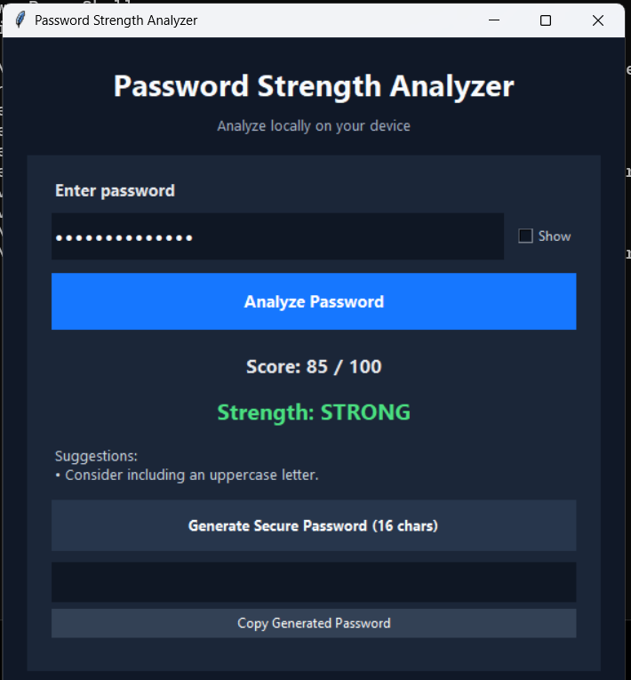

# 🔐 Password Strength Analyzer

A lightweight desktop application built with **Python and Tkinter** that evaluates password composition, provides improvement suggestions, and generates random passwords locally.

> **Important:** This is an educational password-strength estimator, not a breach checker or a guarantee that a password is secure. It does not upload or store the entered password.

## ✨ Features

- **Password strength estimate** with a score out of 100
- **Composition checks** for length, uppercase/lowercase letters, numbers, and special characters
- **Common-password warning** for a small built-in list
- **Actionable suggestions** to improve password composition
- **Secure password generation** using Python's `secrets` module
- **Show/hide password** toggle
- **Copy generated password** to the clipboard
- **Keyboard support** — press Enter to analyze
- **Dark-themed Tkinter interface**
- **Local processing** — no network requests or password storage

## 🧰 Built With

- Python 3.10+
- Tkinter (included with most standard Python installations)
- `secrets`, `string` (Python standard library)

## 🚀 Run Locally

1. Install Python 3.10 or newer.
2. Clone the repository:

   ```bash
   git clone https://github.com/shivarjunchaturvedi/Password-Strength-Analyzer.git
   cd Password-Strength-Analyzer
   ```

3. Launch the app:

   ```bash
   python password_strength_analyzer.py
   ```

On Windows, `py password_strength_analyzer.py` may also work. No third-party Python packages are required.

## 🖼️ Preview



## 📁 Project Structure

```text
Password-Strength-Analyzer/
├── password_strength_analyzer.py  # Tkinter app and password analysis
├── result.png                     # Application screenshot
└── README.md                      # Project documentation
```

## 🧠 How the Score Works

The score is a simple composition-based heuristic that awards points for length and character categories. Passwords in the small common-password list are flagged as very weak.

This score is **not** an estimate of the time required to crack a password. Real-world password safety also depends on uniqueness, reuse, randomness, the attacker's capabilities, and whether the password has appeared in a breach. Long, unique passphrases are often easier to remember and can be safer than predictable character substitutions.

## 🔒 Privacy Notes

- Password analysis happens locally in the app.
- The app does not make network requests or save entered passwords.
- A generated password is briefly held in the app and may be copied to the system clipboard. Treat the clipboard as sensitive and clear it when appropriate.

## 🛠️ Possible Future Improvements

- Add unit tests for score boundaries and password generation
- Expand or replace the small common-password list with a privacy-preserving local dataset
- Add an accessible score indicator and improved keyboard navigation
- Offer adjustable generated-password length

## 👨‍💻 Author

**Shivarjun Chaturvedi**

- GitHub: [@shivarjunchaturvedi](https://github.com/shivarjunchaturvedi)

---

⭐ If you find this project useful, consider starring the repository.
